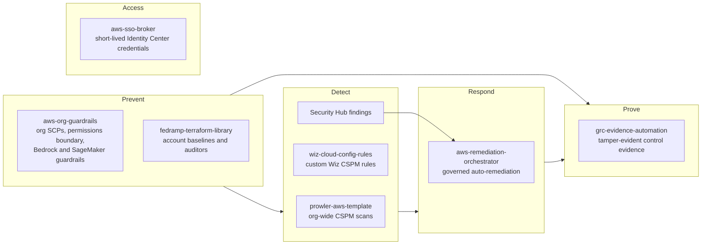

# Dustin Arrington

**Senior Cloud Engineer** focused on AWS multi-account governance and compliance-as-code: FedRAMP (Rev5 and 20x) and NIST 800-53 controls implemented as code on AWS, in both commercial regions and GovCloud.

I build multi-account guardrails, audit evidence pipelines, and remediation workflows that run on short-lived credentials only (OIDC and IAM Identity Center, zero long-lived keys).

The projects use automated tests (Terraform, Python and Rego), CI security scans appropriate to their code, and documented coverage gaps. Where noted, it links to proof from a live deployment.

## Start here

- [**fedramp-terraform-library**](https://github.com/DustyStudy/fedramp-terraform-library): NIST 800-53 Rev5 and FedRAMP 20x controls as Terraform modules, with plan-time policy tests. [Thirteen modules deployed and probed in a real organization](https://github.com/DustyStudy/fedramp-terraform-library/blob/main/docs/LIVE-PROOF.md).
- [**aws-remediation-orchestrator**](https://github.com/DustyStudy/aws-remediation-orchestrator): Security Hub findings routed through policy, blast-radius limits and a human approval gate. [Six playbooks run against a real organization](https://github.com/DustyStudy/aws-remediation-orchestrator/blob/main/docs/PROOF.md), and [one finding traced from detection to evidence](https://github.com/DustyStudy/aws-remediation-orchestrator/blob/main/docs/CASE-STUDY.md).
- [**aws-sso-broker**](https://github.com/DustyStudy/aws-sso-broker): short-lived IAM Identity Center credentials across many accounts, with no long-lived access keys. [Tested against a real Identity Center instance](https://github.com/DustyStudy/aws-sso-broker/blob/main/docs/PROOF.md).

## How the repos fit together

## Also here

- [**aws-org-guardrails**](https://github.com/DustyStudy/aws-org-guardrails): SCPs, a permissions boundary, Identity Center permission sets and Bedrock/SageMaker guardrails for AWS Organizations, tested as policy behavior. [Probed with 62 live API calls](https://github.com/DustyStudy/aws-org-guardrails/blob/main/docs/PROOF.md).
- [**grc-evidence-automation**](https://github.com/DustyStudy/grc-evidence-automation): scheduled, tamper-evident control evidence for SOC 2, ISO 27001, NIST 800-53 and FedRAMP 20x. [Deployed and verified in a live account](https://github.com/DustyStudy/grc-evidence-automation/blob/main/docs/live-deployment-verification.md).
- [**ai-agent-security-toolkit**](https://github.com/DustyStudy/ai-agent-security-toolkit): prompt-injection fuzzer, tool-call sandbox with taint tracking, output validation and a tamper-evident audit log for LLM agents. [Fuzzed with 500 attacks against a local Llama 3.1 8B model](https://github.com/DustyStudy/ai-agent-security-toolkit/blob/main/docs/PROOF.md): forbidden tool calls, leaks and exfiltration went from 65 to zero.
- [**prowler-aws-template**](https://github.com/DustyStudy/prowler-aws-template): org-wide Prowler scans through GitHub Actions and OIDC, with a [documented cost model](https://github.com/DustyStudy/prowler-aws-template/blob/main/docs/COST.md). [Run against a real four-account organization](https://github.com/DustyStudy/prowler-aws-template/blob/main/docs/PROOF.md).
- [**wiz-cloud-config-rules**](https://github.com/DustyStudy/wiz-cloud-config-rules): custom Wiz Cloud Configuration Rules in Rego, mapped to NIST 800-53 and GovCloud-safe, with 146 `opa test` cases.
- [**claude-code-guardrails**](https://github.com/DustyStudy/claude-code-guardrails): guardrails for AI coding agents on AWS and Terraform that block risky commands and catch secrets before they are written.

## Engineering notes

[Design decisions and deployment evidence](ENGINEERING.md): why these systems use
short-lived access, policy-gated remediation and verifiable evidence, with the
scope and limits of each live run.

## Threat-informed hardening

I connect observed attack techniques to specific controls and regression checks.
Each entry in the [threat response log](THREAT-RESPONSE.md) names a technique, the control added for it, and public reporting of attackers using it. The most recent:

- **Backdoored LiteLLM release stealing instance-role credentials:** aws-org-guardrails already required IMDSv2 at launch, which a container on the instance can still use. An opt-in SCP now requires an IMDS hop limit of 1, so containers on bridge networks cannot fetch the instance role's credentials, in [aws-org-guardrails#29](https://github.com/DustyStudy/aws-org-guardrails/pull/29). Seen in the wild: [StepSecurity, 2026](https://www.stepsecurity.io/blog/litellm-1-107-0-compromised-pypi-backdoored-wheels-credential-stealer).

## Tools and platforms

**Cloud:** AWS (including GovCloud) 
**Infrastructure as code:** Terraform, GitHub Actions 
**Languages:** Python, HCL, Rego, PowerShell, Bash 
**Security tooling:** Checkov, Trivy, Gitleaks, Prowler, Wiz, OPA, Security Hub, GuardDuty, AWS Config 
**Frameworks:** FedRAMP Rev5 and 20x, NIST 800-53 Rev5, SOC 2, ISO 27001:2022 
**AI assistance:** I use AI coding assistants (Claude Code) for drafting and review. I design each system, and I verify it with tests and, where noted, live deployments.
