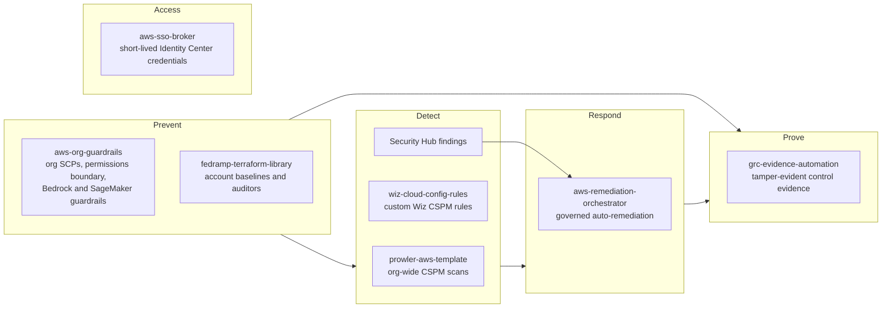

# Dustin Arrington

**Senior Cloud Engineer** focused on AWS multi-account governance and compliance-as-code: FedRAMP (Rev5 and 20x) and NIST 800-53 controls implemented as code on AWS, in both commercial regions and GovCloud.

I build multi-account guardrails, audit evidence pipelines, and remediation workflows that run on short-lived credentials only (OIDC and IAM Identity Center, zero long-lived keys).

The projects use automated tests (Terraform, Python and Rego), CI security scans appropriate to their code, and documented coverage gaps. Where noted, it links to proof from a live deployment.

## Start here

- [**fedramp-terraform-library**](https://github.com/DustyStudy/fedramp-terraform-library): NIST 800-53 Rev5 and FedRAMP 20x controls as Terraform modules, with plan-time tests that check the rendered IAM and bucket policies. [Thirteen modules deployed and probed in a real organization](https://github.com/DustyStudy/fedramp-terraform-library/blob/main/docs/LIVE-PROOF.md), including live connections to the database, the container registry and the web ACL.
- [**aws-remediation-orchestrator**](https://github.com/DustyStudy/aws-remediation-orchestrator): Security Hub findings routed through policy, blast-radius limits and a human approval gate. [All six playbooks run against a real AWS organization](https://github.com/DustyStudy/aws-remediation-orchestrator/blob/main/docs/PROOF.md), and [one finding followed from detection to exported evidence](https://github.com/DustyStudy/aws-remediation-orchestrator/blob/main/docs/CASE-STUDY.md), including an approval whose delivery failed and was recovered.
- [**aws-sso-broker**](https://github.com/DustyStudy/aws-sso-broker): short-lived IAM Identity Center credentials across many accounts, with no long-lived access keys. [Tested against a real Identity Center instance](https://github.com/DustyStudy/aws-sso-broker/blob/main/docs/PROOF.md).

## How the repos fit together

## Also here

- [**aws-org-guardrails**](https://github.com/DustyStudy/aws-org-guardrails): SCPs, a permissions boundary and Identity Center permission sets for AWS Organizations, tested as policy behavior against the JSON Terraform renders, plus Bedrock and SageMaker guardrails: SCPs, agent IAM audits, invocation-logging enforcement and cost controls. [SCPs, the boundary and a permission set probed with 62 live API calls](https://github.com/DustyStudy/aws-org-guardrails/blob/main/docs/PROOF.md).
- [**grc-evidence-automation**](https://github.com/DustyStudy/grc-evidence-automation): scheduled, tamper-evident control evidence for SOC 2, ISO 27001, NIST 800-53 and FedRAMP 20x. [Deployed and verified in a live account](https://github.com/DustyStudy/grc-evidence-automation/blob/main/docs/live-deployment-verification.md).
- [**ai-agent-security-toolkit**](https://github.com/DustyStudy/ai-agent-security-toolkit): prompt-injection fuzzer, tool-call sandbox with taint tracking, output validation and a tamper-evident audit log for LLM agents.
- [**prowler-aws-template**](https://github.com/DustyStudy/prowler-aws-template): org-wide Prowler scans with a [documented cost model](https://github.com/DustyStudy/prowler-aws-template/blob/main/docs/COST.md) with GitHub Actions, OIDC and StackSet read-only roles. [Run against a real four-account organization](https://github.com/DustyStudy/prowler-aws-template/blob/main/docs/PROOF.md).
- [**wiz-cloud-config-rules**](https://github.com/DustyStudy/wiz-cloud-config-rules): custom Wiz Cloud Configuration Rules for AWS in Rego, mapped to NIST 800-53, with a Terraform module that loads them into a tenant. Missing data fails instead of passing, and no rule hard-codes the partition, so the rules work in GovCloud. 146 `opa test` cases across nine rules.

## Engineering notes

[Design decisions and deployment evidence](ENGINEERING.md): why these systems use
short-lived access, policy-gated remediation and verifiable evidence, with the
scope and limits of each live run.

## Threat-informed hardening

I connect observed attack techniques to specific controls and regression checks.
Each entry in the [threat response log](THREAT-RESPONSE.md) names a technique, the control added for it, and public reporting of attackers using it. The most recent:

- **Service-specific credentials added to compromised IAM users:** the guardrail SCPs already denied new IAM users, access keys and console passwords, and the credential playbook deactivated access keys. An opt-in SCP now denies new Bedrock API keys and other service-specific credentials, in [aws-org-guardrails#26](https://github.com/DustyStudy/aws-org-guardrails/pull/26), and the playbook deactivates existing ones, in [aws-remediation-orchestrator#34](https://github.com/DustyStudy/aws-remediation-orchestrator/pull/34). Seen in the wild: [FortiGuard Labs, 2026](https://www.fortinet.com/blog/threat-research/someone-else-is-using-your-ai).

## Tools and platforms

**Cloud:** AWS (including GovCloud) 
**Infrastructure as code:** Terraform, GitHub Actions 
**Languages:** Python, HCL, Rego, PowerShell, Bash 
**Security tooling:** Checkov, Trivy, Gitleaks, Prowler, Wiz, OPA, Security Hub, GuardDuty, AWS Config 
**Frameworks:** FedRAMP Rev5 and 20x, NIST 800-53 Rev5, SOC 2, ISO 27001:2022 
**AI assistance:** I use AI coding assistants (Claude Code) for drafting and review. I design each system, and I verify it with tests and, where noted, live deployments.
