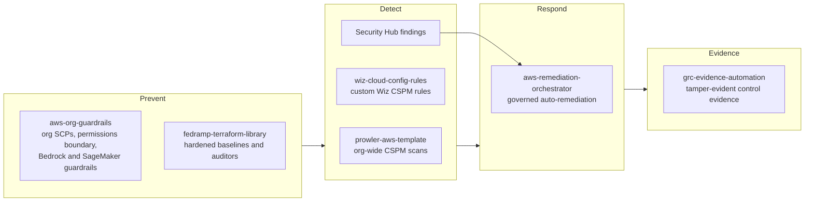

# Dustin Arrington

I build and test AWS defenses for credential misuse, privilege escalation, persistence, and resource hijacking.

I test rendered policies in CI and run selected controls in a four-account AWS organization. The project guides link to test results and deployment evidence.

## Start here

- [**aws-org-guardrails**](https://github.com/DustyStudy/aws-org-guardrails): applies organization-wide policies for IAM, logging, and AI workloads. [See the operations allowed and denied in a live sandbox OU](https://github.com/DustyStudy/aws-org-guardrails/blob/main/docs/PROOF.md).
- [**aws-remediation-orchestrator**](https://github.com/DustyStudy/aws-remediation-orchestrator): responds to Security Hub findings through policy, blast-radius limits and a human approval gate. [Follow a finding from detection to evidence](https://github.com/DustyStudy/aws-remediation-orchestrator/blob/main/docs/CASE-STUDY.md).
- [**ai-agent-security-toolkit**](https://github.com/DustyStudy/ai-agent-security-toolkit): prompt-injection fuzzer, tool-call sandbox with taint tracking, output validation and a tamper-evident audit log for LLM agents. [Llama 3.1 8B evaluation, v0.12.0 release candidate](https://github.com/DustyStudy/ai-agent-security-toolkit#measured-results): 177 of 498 cases succeeded against the model alone (35.5%), and 2 of 497 succeeded with the toolkit enabled (0.4%).

## Threat-informed hardening

The [threat response log](THREAT-RESPONSE.md) maps AWS attack techniques to controls I added and the tests I ran. Each entry identifies the public evidence available, such as an incident report or a vulnerability disclosure, and notes where evidence is missing. A few examples:

| Technique | What I shipped |
|---|---|
| Backups deleted or made unrecoverable before ransomware ([T1490](https://attack.mitre.org/techniques/T1490/)) | Opt-in AWS Backup Vault Lock and deny-delete vault policy, plus an SCP against backup destruction: [fedramp-terraform-library#94](https://github.com/DustyStudy/fedramp-terraform-library/pull/94), [aws-org-guardrails#54](https://github.com/DustyStudy/aws-org-guardrails/pull/54) |
| Privilege escalation by passing a more privileged role, or trusting every principal ([T1078.004](https://attack.mitre.org/techniques/T1078/004/)) | Auditor reports `iam:PassRole` on all roles and trust policies that allow any principal or an outside account without `sts:ExternalId`: [grc-evidence-automation#48](https://github.com/DustyStudy/grc-evidence-automation/pull/48) |
| Long-lived cloud keys, broad IAM actions and cloud credentials stored in workflows ([T1552.001](https://attack.mitre.org/techniques/T1552/001/)) | Lint flags long-lived cloud keys, broad IAM actions and stored cloud credentials in workflows: [claude-code-guardrails v0.8.0](https://github.com/DustyStudy/claude-code-guardrails/releases/tag/v0.8.0) |

## How the repos fit together

## More projects

- [**fedramp-terraform-library**](https://github.com/DustyStudy/fedramp-terraform-library): hardened AWS account baseline modules and read-only auditors, with plan-time tests of the rendered IAM and bucket policies. [Sixteen deployed and probed in a real organization](https://github.com/DustyStudy/fedramp-terraform-library/blob/main/docs/LIVE-PROOF.md), where the read-only trust-policy auditor found a GitHub OIDC deploy role that any branch could assume. Mapped to NIST 800-53 Rev5 and FedRAMP.
- [**prowler-aws-template**](https://github.com/DustyStudy/prowler-aws-template): org-wide Prowler scans through GitHub Actions and OIDC, with a [documented cost model](https://github.com/DustyStudy/prowler-aws-template/blob/main/docs/COST.md). [Run against a real four-account organization](https://github.com/DustyStudy/prowler-aws-template/blob/main/docs/PROOF.md).
- [**wiz-cloud-config-rules**](https://github.com/DustyStudy/wiz-cloud-config-rules): custom Wiz Cloud Configuration Rules in Rego, with [OPA tests for missing fields and GovCloud ARNs](https://github.com/DustyStudy/wiz-cloud-config-rules#validation-status).
- [**claude-code-guardrails**](https://github.com/DustyStudy/claude-code-guardrails): guardrails for AI coding agents on AWS and Terraform that block risky commands and catch secrets before they are written.
- [**grc-evidence-automation**](https://github.com/DustyStudy/grc-evidence-automation): scheduled, tamper-evident control evidence for SOC 2, ISO 27001, NIST 800-53 and FedRAMP 20x. [Deployed and verified in a live account](https://github.com/DustyStudy/grc-evidence-automation/blob/main/docs/live-deployment-verification.md).

## Engineering notes

[Design decisions and deployment evidence](ENGINEERING.md): how a finding moves through the system, what the live runs establish, and the cost and operating limits of each.

## Tools and platforms

**Cloud:** AWS, including GovCloud 
**Security:** Security Hub, GuardDuty, AWS Config, IAM Access Analyzer, Prowler, Wiz, OPA/Rego, Checkov, Trivy, Gitleaks, MITRE ATT&CK 
**Infrastructure as code:** Terraform, GitHub Actions (OIDC, no static keys) 
**Languages:** Python, HCL, Rego, PowerShell, Bash 
**Compliance:** NIST 800-53 Rev5, FedRAMP Rev5 and 20x, SOC 2, ISO 27001:2022. I map controls to these frameworks; they aren't the goal. 
**AI assistance:** I use AI coding assistants (Claude Code) for drafting and review. I design each system, and I verify it with tests and, where noted, live deployments.
